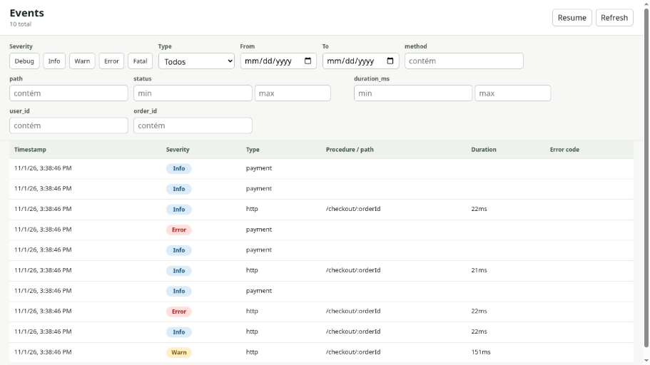

# Trail

**Typed wide-event observability for Bun, with SQLite storage and a local event explorer.**

[](https://github.com/juicerq/trail/actions/workflows/check.yml)
[](https://github.com/juicerq/trail/actions/workflows/test.yml)
[](https://www.npmjs.com/package/@juicerq/trail)
[](LICENSE)

Collect request context as work happens, then write a structured event when the scope ends. Inspect HTTP requests, RPC calls, errors, and related events using a local SQLite database.



_Real Studio UI, fictional checkout data. [Run the example](examples/README.md) to explore it yourself._

[Core reference](packages/trail/README.md) · [Studio guide](packages/trail-studio/README.md) · [Architecture](docs/architecture.md)

## Why wide events?

For a checkout request, the useful context is spread across the request handler, payment call, and error handler. Trail lets those parts enrich the current event without passing a logger through every function.

1. The Hono middleware starts an HTTP event.
2. The handler adds `user_id`, `order_id`, and `amount_cents` with `obs.enrich()`.
3. A nested payment scope gets its own event, linked through `parent_id`.
4. When each scope ends, Trail writes its event to SQLite. The middleware adds status and duration; thrown errors are captured automatically.
5. Studio reads that database so you can filter events and follow their relationships, even after the app stops.

## Quick start

Requires **Bun 1.3+**. Trail publishes TypeScript source and uses Bun's SQLite driver; Node.js is not supported.

```sh
bun add @juicerq/trail
```

```ts
import { createObservability, type BaseEvent } from "@juicerq/trail/core";
import { sqliteStore } from "@juicerq/trail/sqlite";

type Event = BaseEvent & {
	type: "checkout";
	order_id: string;
	amount_cents?: number;
};

const obs = createObservability({
	service: "checkout-api",
	store: sqliteStore<Event>({
		dbPath: "./obs.db",
		columns: { order_id: { type: "text", index: true } },
	}),
});

await obs.context({ type: "checkout", order_id: "ord_1042" }, async () => {
	obs.enrich({ amount_cents: 4900 });
});

await obs.flush();
```

Open the database in Studio:

```sh
bunx @juicerq/trail-studio --db ./obs.db
```

## Explore the checkout demo

```sh
git clone https://github.com/juicerq/trail.git
cd trail
bun install --frozen-lockfile
bun packages/trail/examples/checkout.ts
bun run --cwd packages/trail-studio build
bun packages/trail-studio/src/cli.ts --db ./.data/checkout.db
```

The demo runs five in-process HTTP requests: three successful checkouts, one slow checkout, and one failed payment. It writes ten linked HTTP/payment events without starting an application server or contacting a payment provider. See the [walkthrough](examples/README.md).

## Packages

| Package                                          | Purpose                                                                      |
| ------------------------------------------------ | ---------------------------------------------------------------------------- |
| [`@juicerq/trail`](packages/trail)               | Typed event scopes, SQLite and memory stores, Hono/oRPC/tRPC adapters        |
| [`@juicerq/trail-studio`](packages/trail-studio) | Local readonly event explorer with filters, related events, and live polling |

## Design choices

- **Async context:** `AsyncLocalStorage` keeps concurrent scopes separate and links nested events.
- **Explicit SQL columns:** promote the fields you need to filter; other fields stay in `extra` JSON.
- **Local persistence:** SQLite runs in WAL mode so Studio can read while the app writes.
- **Small integration surface:** use individual subpath imports for the core, stores, and adapters.
- **Local investigation:** Studio reads the database directly and binds to `127.0.0.1` by default.

The [architecture notes](docs/architecture.md) explain the trade-offs and current boundaries.

## Status and scope

Trail is a personal project with an early **0.1.x** API. It is Bun-only. Studio currently supports Trail's SQLite schema and is a local, readonly tool without built-in authentication. Hosted dashboards, alerting, and OpenTelemetry export are outside the current scope.

## Development

```sh
bun install --frozen-lockfile
bun run check
bun run lint
bun run format:check
bun run test
bun run --cwd packages/trail-studio build
```

## License

[MIT](LICENSE)
