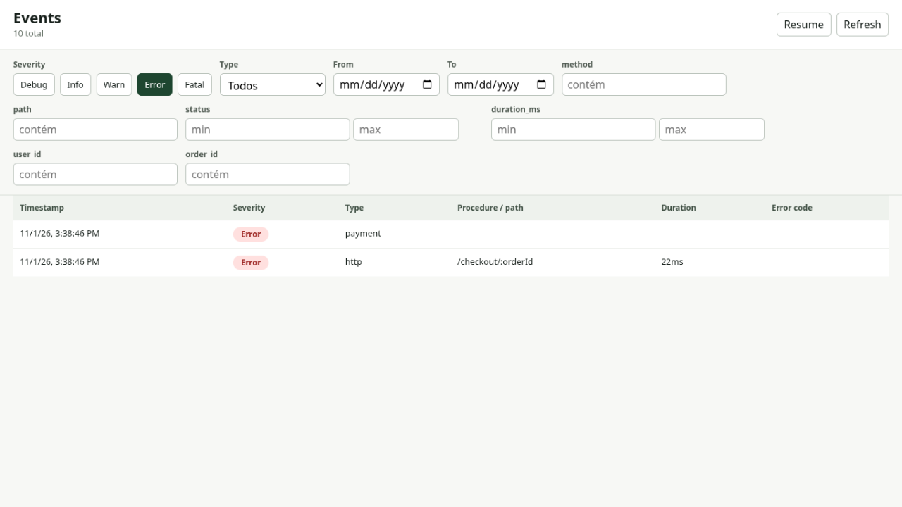

# Checkout walkthrough

Run this example from the repository root with Bun 1.3+:

```sh
bun install --frozen-lockfile
bun packages/trail/examples/checkout.ts
bun run --cwd packages/trail-studio build
bun packages/trail-studio/src/cli.ts --db ./.data/checkout.db
```

All requests run in-process through Hono. The payment provider, users, and orders are fictional; no external service is called. The database lives in the ignored `.data/` directory. Each run appends another ten events. Stop Studio and remove `.data/checkout.db`, `.data/checkout.db-wal`, and `.data/checkout.db-shm` if present to start fresh.

## Follow one request

[`checkout.ts`](../packages/trail/examples/checkout.ts) creates a SQLite store and installs Trail's Hono middleware. A `POST /checkout/ord_1042` starts an HTTP scope; the handler adds the user, order, and amount to that event. A nested `payment` scope simulates the provider call. Its error propagates through the HTTP scope and both events are saved with error details.

The HTTP event includes the normalized route `/checkout/:orderId`, response status `503`, and duration. The payment event points back to it through `parent_id`.

## Investigate in Studio

1. Open the event list. A fresh database has ten events: five HTTP and five payment events.
2. Select **warn** to find `ord_1041`, whose simulated payment takes at least 150 ms and crosses the middleware's 100 ms threshold.
3. Deselect **warn** and select **error** to find the failed checkout and payment for `ord_1042`.
4. Open either failed event and inspect the error payload. Follow the related event to move between the request and payment scopes.
5. Clear the severity filter and enter `ord_1042` in the `order_id` field to see both events for that order.



`httpColumns` declares the middleware's SQL fields. The example also indexes `user_id` and `order_id`. Fields such as `amount_cents` and `provider` remain in `extra` JSON and are visible in the detail drawer, but are not SQL filter columns.

The 100 ms threshold is deliberately low for this demo. On a heavily loaded machine, additional requests may also be marked as slow.
