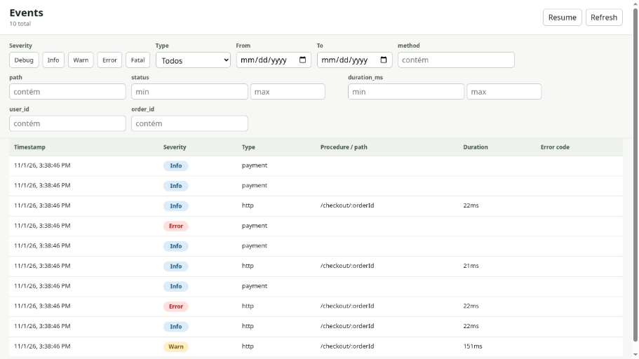

# @juicerq/trail-studio

**A local, readonly event explorer for Trail's SQLite stores.**

Filter by severity, event type, time, and declared columns. Open events to inspect their fields and navigate parent/child relationships. Live tail refreshes the list every three seconds.



## Get started

Requires **Bun 1.3+** and a database created by [`@juicerq/trail/sqlite`](../trail/README.md).

```sh
bunx @juicerq/trail-studio --db ./obs.db
```

Studio starts on `127.0.0.1`, chooses an available port, and opens your browser. The source application can keep writing to the database or be stopped entirely.

To install it in your project instead:

```sh
bun add -D @juicerq/trail-studio
bunx trail-studio --db ./obs.db
```

Want sample data? Follow the [checkout walkthrough](../../examples/README.md).

## Inspect events

- Select one or more severities and an event type to narrow the list.
- Filter declared SQL columns by text or numeric range. Undeclared fields remain in `extra` JSON and can be inspected in the detail drawer.
- Open an event to inspect its fields, error payload, ancestors, and children.
- Click **Pause** to freeze live tail. A badge counts new matching events; click it to return to the latest events.
- Filters stay in the URL so you can return to the same view while the local server is running.

## CLI options

| Option        | Behavior                                            |
| ------------- | --------------------------------------------------- |
| `--db <path>` | Database file; defaults to `$DB_PATH` or `./obs.db` |
| `--port <n>`  | Fixed port; otherwise an available port is chosen   |
| `--host <ip>` | Bind address; defaults to `127.0.0.1`               |
| `--no-open`   | Do not open a browser automatically                 |
| `--no-live`   | Start with live tail paused                         |
| `--help`      | Show usage                                          |

## Inspect a production snapshot

Create a consistent snapshot on the source host using SQLite's backup command, then copy that snapshot:

```sh
ssh prod 'sqlite3 /var/lib/app/obs.db ".backup /tmp/trail-snapshot.db"'
scp prod:/tmp/trail-snapshot.db ./snap.db
bunx @juicerq/trail-studio --db ./snap.db
```

A live WAL database may have recent writes in its `-wal` file; copying only the main `.db` file can omit them. SQLite's backup command includes committed data in a consistent snapshot. The source host needs the `sqlite3` CLI.

## Inspect through an SSH tunnel

Run Studio on the remote host and forward its loopback port:

```sh
ssh -L 52184:127.0.0.1:52184 prod \
  'bunx @juicerq/trail-studio --db /var/lib/app/obs.db --port 52184 --no-open'
```

Open `http://127.0.0.1:52184` locally. Studio has no built-in authentication; keep its default loopback binding and use SSH for remote access.

## Develop from source

From the repository root:

```sh
bun install --frozen-lockfile
bun packages/trail/examples/checkout.ts
bun run --cwd packages/trail-studio build
bun packages/trail-studio/src/cli.ts --db ./.data/checkout.db
```

For client development, run the CLI with `--port 4321 --no-open`, then run `bun run --cwd packages/trail-studio dev` in another terminal. Vite proxies `/api` to port 4321.

See the [architecture notes](../../docs/architecture.md) for the storage contract, packaging decisions, and scope.

## License

[MIT](LICENSE)
